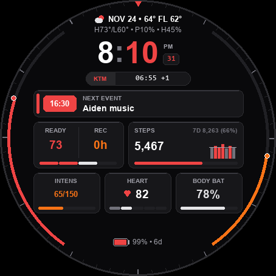

# FR570 Runner Pro — Design & Engineering Notes (What Made It Work)

A quick reference capturing the key discoveries from tuning this custom Garmin Forerunner 570 (`47mm` `454×454` / `42mm` `390×390`) AMOLED watch face from an overcrowded first build into a crisp, flagship-grade chronograph UI.

---

## 1. The 1:1 Physical 47mm Preview Rule
- **Why desktop previews lied:** A `454×454` image displayed on a ~100 PPI monitor spans ~4.5 inches — over **3.2× wider** than the Forerunner 570's actual **1.4-inch (35.5 mm)** screen (~324 PPI). Text that looked spacious on a desktop monitor shrank to sub-millimeter smudges at 12–18 inches on the wrist.
- **Fix:** Always render a **1:1 physical wrist-scale composite** (`render_actual_47mm.py` → `actual_47mm_size_preview.png`, `140×140` px screen inside `185×185` px 47mm case + millimeter scale ruler) alongside every code change, plus a **`1:1 Watch Size (1.4")`** toggle inside `studio/fr570_watchface_studio.html`.

---

## 2. TrueType Vector Fonts Instead of Garmin's Bitmap/Default Font Constants
- **Problem:** Inspecting `fr57047mm/simulator.json` showed that Garmin's standard `Graphics.FONT_XTINY` renders at `37px` tall and `FONT_TINY` at `47px` tall on the 454px AMOLED screen, causing text blocks to collide across cards (`READRECOVERSTEPS`).
- **Fix:** Switched to Garmin's on-device TrueType system font **`RobotoCondensedBold`** (with `RobotoRegular` fallback) via `Graphics.getVectorFont({ :face => ..., :size => ... })` scaled proportionally by `width / 454.0`.
- **Critical Typography Calibration:**
  - FreeType `:size` includes internal ascender/descender cell padding, and thin regular-weight `12px–17px` labels vanish at 324 PPI.
  - Switching **all 6 tiers to Bold** and bumping sizes until readable at 1:1 scale solved wrist legibility completely:
    - `_fLabel` (pod titles & forecast line 2): **`22px`**
    - `_fSmall` (date/temp, seconds pill, `KTM`, `07:00`, battery): **`26px`**
    - `_fEvent` (calendar event title): **`32px`**
    - `_fMidValue` / `_fValue` (hero numbers `82`, `0h`, `5,467`, `65m`, `69`, `82%`): **`36px`–`44px`** (selected dynamically via `selectValueFont`)
    - `_fTime` (digital clock `6:48`): **`98px`** (with `timeY + fontHeight * 0.84` return anchor to strip dead descender padding)

---

## 3. Round-Dial Fluid Geometry vs. Boxy Rectangles
- **Problem:** Rectangular 1px wireframe boxes fought against the circular hardware bezel, and the bottom corners of Row 2 clipped near the lower circular arc rails.
- **Fix:** Replaced rectangular cards with **circular and stadium-pill geometry**:
  - **270° Circular Ring Dials (`drawCircularRingGauge`):** Drawn clockwise from `225°` to `315°` with a glowing white-ringed progress dot at the tip and the pod label (`READY`, `INTENS`, `HEART`, `BODY`) nested cleanly in the 90° bottom gap.
  - **Full-Round Stadium Ribbons (`radius = height / 2`):** Used on the world clock (`KTM | 17:33`), calendar event ribbon (`07:00 | Aiden music`), and seconds capsule.
  - **4 Switchable Layout Styles (`CardStyle`):**
    - **`0` — 1. Chrono Ring Dials & Stadium Ribbon *(Default)*:** Notched halo outer arcs, 270° `READY` ring + `REC` pill + rounded `STEPS` bay, and 3 bottom circular ring dials.
    - **`1` — 4. Segmented Tach & Panoramic Cockpit Bay:** 12-segment curved tachometer outer arcs, slanted racing-cut `KTM`/`07:00` badges, one unified Row 1 cockpit bay, and ticked 270° bottom sub-dials.
    - **`2` — 1+4 Hybrid:** Notched chrono halo bezel + stadium ribbons paired with the unified Row 1 cockpit bay and 3 bottom circular ring dials.
    - **`3` — 3. Seamless Pitch-Black AMOLED HUD:** Pure `0x000000` canvas with tapered laser hairlines, center Crimson diamond node, and curved crescent bottom smile-arcs (`220°` counter-clockwise to `320°`).

---

## 4. Ruthless String Compaction for Glanceability
Every redundant character steals pixel height from the numbers you actually want to read:
- **Intensity Dial:** `"65/150"` → **`"65m"`** inside the ring while the 270° orange arc tracks percentage toward the 150-minute goal (lets the number jump from tiny to `36px–44px` bold).
- **Bottom-Right Pod Label:** `"BODY BAT"` → **`"BODY"`**.
- **Steps Target Summary:** `"7D 8,263 (66%)"` → **`"8,263"`**.
- **Calendar Card:** Removed the tiny static `"NEXT EVENT"` header line so `"Aiden music"` expands vertically to **`32px` bold**.
- **Weather Bar:** Trimmed redundant feels-like/humidity noise (`"NOV 25 • 59°"` and `"H65° L56° • 55%"`).

---

## 5. High-Contrast AMOLED Palette (Zero Blue)
- Pure neon greens/blues (`0x00FF66` + navy cards) looked dated and low-contrast on AMOLED glass.
- Default palette (**Stealth Graphite & Racing Crimson**):
  - Pitch charcoal background (`0x09090B`) & neutral gunmetal cards (`0x17171A`, border `0x2C2C30`, top specular highlight `0x3F3F46`)
  - High-visibility **Racing Crimson (`0xEF4444`)**, **Tactical Orange (`0xF97316`)**, **Platinum White (`0xE4E4E7`)**, and near-white pod labels (`0xE4E4E7` / `0xD4D4D8`)
  - Plus **3 alternate non-blue themes**: *Warm Carbon & Solar Gold*, *Warm Bronze & Champagne*, and *Light Titanium / Alabaster*.

---

## 6. Garmin Connect IQ Beta & Deployment Quirks Solved
- **Manifest Version Schema:** `manifest.xml` strictly requires `X.Y.Z` semantic format (`1.2.0`), never `1.1`.
- **Web Form Version vs. Manifest Version:** Garmin's Connect IQ Developer Portal displays the version typed into the **Upload New Version** web field on the store listing; always bump it alongside `manifest.xml`.
- **GDPR Notice on Upload:** Triggered automatically because `manifest.xml` declares `Communications` permission (used solely for the optional user-configured calendar JSON bridge; no user data is collected or transmitted externally).
- **Forcing Updates on Beta Apps:** The Connect IQ mobile app caches Beta apps aggressively and often hides the **Update** button under *My Watch Faces*. Uninstalling the old watch face on the phone, reinstalling directly from the app's Connect IQ URL (`?v=...` if web-cached), and syncing **Garmin Connect** pulls the new `.iq` immediately.
